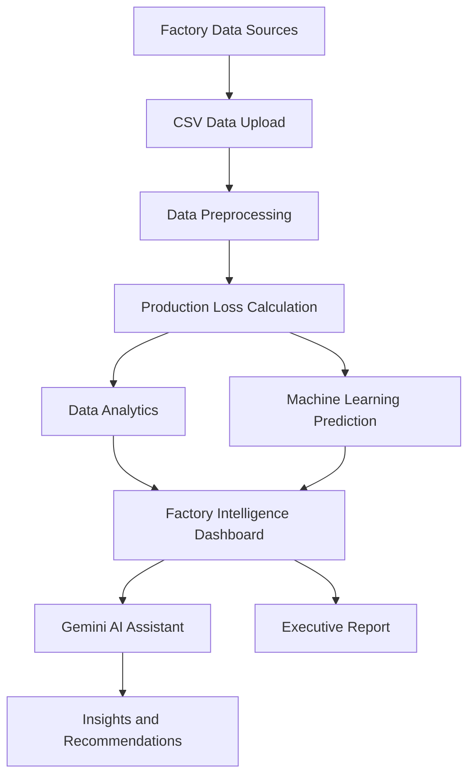

# 🏭 AI Production Loss Analysis & Factory Intelligence Agent

<p align="center">
  <strong>An AI-powered factory analytics application for understanding production losses, monitoring operational performance, and supporting data-driven decisions.</strong>
</p>

<p align="center">
  
  
  
  
</p>

<p align="center">
  <a href="https://github.com/muzammil7829/production-loss-agent">GitHub Repository</a>
</p>

---

## 📌 Overview

The **AI Production Loss Analysis & Factory Intelligence Agent** is a data-driven application designed to help manufacturing environments analyze production performance and understand the reasons behind production losses.

The application processes factory production data, identifies differences between target and actual production, analyzes downtime, estimates financial impact, and provides AI-assisted insights and recommendations.

It combines **Machine Learning, Data Analytics, Interactive Visualization, and Generative AI** in a single dashboard.

## 🎯 Problem Statement

Manufacturing industries can experience production losses due to equipment failures, utility interruptions, maintenance activities, and operational inefficiencies.

Analyzing these problems manually can make it difficult to identify major loss contributors and take timely corrective action.

This project aims to simplify production loss analysis by transforming factory data into meaningful insights that support better operational decisions.

## ✨ Key Features

| Feature | Description |
|---|---|
| 📊 Production Dashboard | Displays target production, actual production, total loss, and efficiency. |
| 📁 CSV Data Upload | Accepts factory production, downtime, and target data. |
| 🔍 Loss Analysis | Calculates production loss and identifies major loss contributors. |
| ⚙️ Downtime Analysis | Analyzes machine downtime and associated reasons. |
| 🤖 ML-Based Prediction | Uses Linear Regression to estimate the next production-loss value from historical loss data. |
| 🧠 Gemini AI Assistant | Allows users to ask questions about factory performance and receive AI-generated insights. |
| 💰 Cost Analysis | Estimates the financial impact of production losses. |
| 📈 Interactive Charts | Visualizes production trends, loss categories, downtime, and cost impact. |
| 📄 Executive Report | Generates an AI-assisted factory performance report. |
| 💡 Recommendations | Provides suggestions based on identified loss categories and analysis. |

## 🛠️ Technology Stack

| Category | Technologies |
|---|---|
| Programming Language | Python |
| Frontend / Dashboard | Streamlit |
| Data Processing | Pandas, NumPy |
| Machine Learning | Scikit-learn |
| Visualization | Plotly |
| Generative AI | Google Gemini API |
| Development Tools | VS Code, Git, GitHub |

## 🏗️ System Architecture



## ⚙️ How It Works

1. **Data Input:** Users upload production, downtime, and target-production CSV files.
2. **Data Processing:** The application validates, cleans, and combines the uploaded datasets.
3. **Loss Calculation:** Production loss and efficiency are calculated.
4. **Loss Classification:** Losses are grouped into equipment, utility, planned, and human-related categories.
5. **Predictive Analysis:** A Linear Regression model estimates the next production-loss value using historical loss data.
6. **AI Analysis:** Gemini AI assists users in understanding factory performance and generating insights.
7. **Visualization:** Results are displayed through interactive dashboards, charts, and reports.

## 📐 Key Calculations

**1. Production Loss**

```python
Loss = TargetProduction - ActualProduction
```

**2. Production Efficiency**

```python
Efficiency = (ActualProduction / TargetProduction) * 100
```

**3. Estimated Financial Impact**

```python
LossCost = Loss * 10
```

*Note: The current implementation uses an estimated cost factor of ₹10 per unit of production loss.*

## 📂 Project Structure

```text
production-loss-agent/
│
├── app.py                 # Main Streamlit application
├── app_v2.py              # Additional application version
├── prediction.py          # Machine Learning prediction logic
├── gemini_ai.py           # Gemini AI integration
│
├── scada.csv              # SCADA production data (if included)
├── downtime.csv           # Downtime information (if included)
├── targets.csv            # Target production data (if included)
├── production_data.csv    # Sample production dataset (if included)
│
├── requirements.txt       # Python dependencies
├── README.md              # Project documentation
└── .gitignore             # Git ignored files
```

## 🚀 Installation and Setup

Follow these steps to run the project locally.

### 1. Clone the Repository

```bash
git clone https://github.com/muzammil7829/production-loss-agent.git
```

### 2. Navigate to the Project Folder

```bash
cd production-loss-agent
```

### 3. Create a Virtual Environment (Recommended)

```bash
python -m venv venv
```

Activate it on Windows:

```bash
venv\Scripts\activate
```

### 4. Install Dependencies

```bash
python -m pip install -r requirements.txt
```

### 5. Run the Application

```bash
python -m streamlit run app.py
```

### 6. Open the Dashboard

Open the local URL displayed in your terminal. By default:

```text
http://localhost:8501
```

## 📊 Expected Input Data

The application works with factory data supplied through CSV files. The expected fields include:

**SCADA Production Data**

| Column | Description |
|---|---|
| Date | Production date |
| Machine | Machine identifier |
| ActualProduction | Actual production quantity |

**Downtime Data**

| Column | Description |
|---|---|
| Date | Downtime date |
| Machine | Machine identifier |
| Downtime | Downtime duration |
| Reason | Reason for downtime |

**Target Production Data**

| Column | Description |
|---|---|
| Date | Production date |
| TargetProduction | Planned production quantity |

Use the expected column names and compatible date formats when preparing input files.

## 🔮 Future Enhancements

- Real-time factory data integration through SCADA and IoT systems.
- Continuous machine-condition monitoring.
- Early-warning detection before production losses occur.
- Advanced predictive models for improved forecasting.
- Configurable production-risk scoring and alert notifications.
- More detailed root-cause analysis.
- Integration with factory maintenance workflows.

*These are planned enhancements and are not all part of the current implementation.*

## ⚠️ Current Limitations

- The application currently relies on uploaded datasets rather than continuous live SCADA monitoring.
- The current prediction model is a baseline Linear Regression implementation.
- Forecast quality depends on the quantity and quality of historical data.
- The estimated financial impact uses a configurable-in-code assumption rather than actual factory accounting data.
- AI-generated insights depend on the availability and configuration of the Gemini API.

## 👨‍💻 Author

**Muzammil**

B.Tech – Computer Science and Engineering  
Dayananda Sagar University, Bengaluru

- GitHub: [@muzammil7829](https://github.com/muzammil7829)
- Project Repository: [production-loss-agent](https://github.com/muzammil7829/production-loss-agent)

## 📜 Academic Project

Developed as part of the **Ready to Deploy (RTD) 2026 Boot Camp – Open Elective Project**.

---

<p align="center">
  <strong>🏭 Turning Factory Data into Actionable Intelligence.</strong>
</p>
